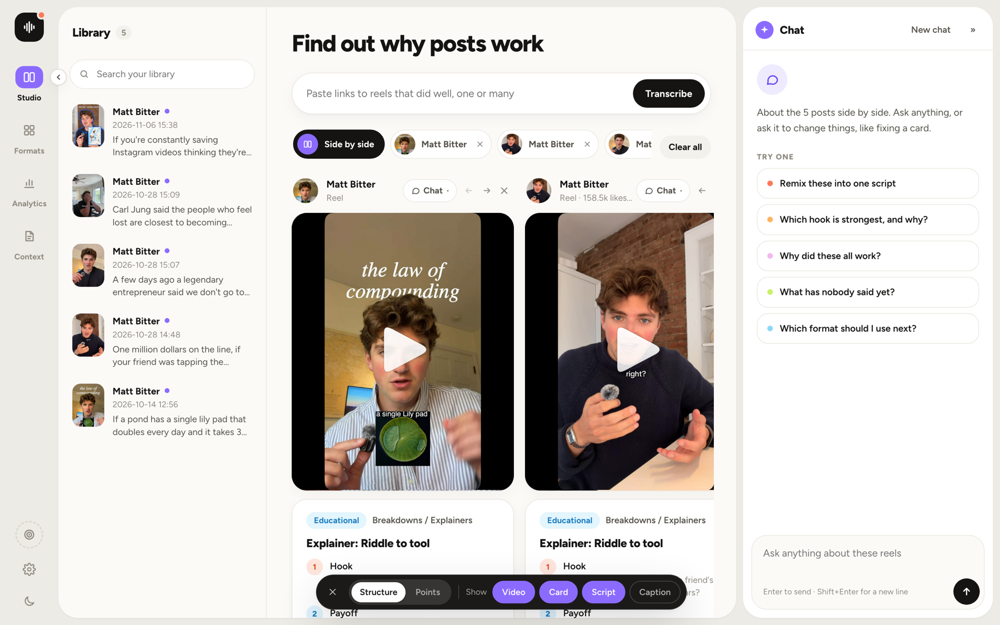
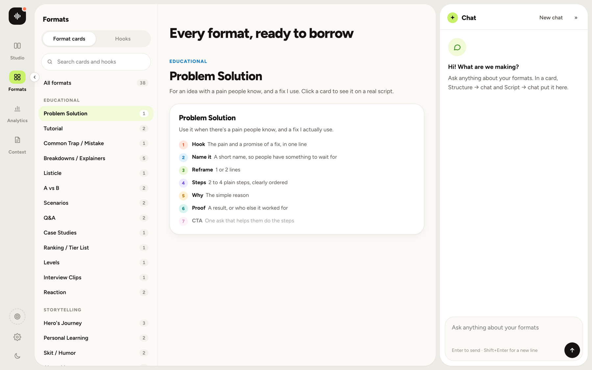

# Unreel Engine

Paste an Instagram reel link. Get its words, the format it follows, and what keeps people watching, line by line. Then write your own version with AI, in your voice.

It runs on your computer. Your reels, notes and keys stay on your computer.

## What's in it

- **Studio.** Paste links to reels that did well. Each one gets transcribed and broken down: the hook, the format it follows, what every line is doing, and the main points it makes. Put a few side by side to compare them.
- **Formats.** A library of reel formats. Each one is a card with its beats in order, like Hook, Reframe, Steps, CTA. Click a card to see a real reel that uses it.
- **Analytics.** Connect your Instagram to see how your own reels are doing. Each reel is held up against your typical one, so you can tell what's actually working.
- **Context.** Tell the AI who you are, who your reels are for and how you talk, so the scripts it writes sound like you.
- **Chat.** On every page. Ask why a reel worked, get hooks for your audience, or have it write a script.

It comes with 5 sample reels by the creator Matt Bitter, already broken down, so you can look around before you add your own.

## What you need

- A Mac or a Windows computer.
- **Python 3.9 or newer.** Most Macs already have it. Get it from [python.org/downloads](https://www.python.org/downloads/). On Windows, tick "Add python.exe to PATH" on the first screen of the installer.
- **One of these, for the AI:**
  - a Claude Pro or Max plan, with [Claude Code](https://claude.com/claude-code) installed
  - an [Anthropic API key](https://console.anthropic.com)
  - a ChatGPT plan, with [Codex](https://developers.openai.com/codex) installed
- **Google Chrome**, logged in to Instagram. Some reels only download when you're logged in.
- Optional: **ffmpeg**, only for reading the text that's shown on screen in a reel. Mac: `brew install ffmpeg`. Windows: `winget install ffmpeg`.

## Set it up

1. **Download it.** Click the green **Code** button at the top of this page, then **Download ZIP**. Unzip it somewhere you'll find it again, like your Documents folder.
2. **Start it.**
   - Mac: double-click **Start (Mac).command**. If your Mac says it can't be opened, open System Settings, go to Privacy & Security, scroll down and click **Open Anyway**. Then double-click it again.
   - Windows: double-click **Start (Windows).bat**.

   The first time takes a few minutes, because it installs what it needs. Then a page opens in your browser.
3. **Pick your AI.** The app asks the first time. More on the options below.
4. **Add a reel.** In Studio, paste a reel link and press **Transcribe**. The very first one downloads the speech model (about 500 MB), so give it a few minutes. After that, each reel takes seconds.

Keep the black window open while you use the app. Close it to stop. To open the app again later, double-click the start file again.

## Which AI should I pick?

| Option | What it costs | You need | Good if |
|---|---|---|---|
| Your Claude account | Nothing extra. It counts toward your plan's usage. | Claude Pro or Max, and Claude Code | You already pay for Claude |
| An Anthropic API key | About 1 to 3 cents per breakdown or script | An account at console.anthropic.com with a few dollars of credit | You have API credits |
| Your ChatGPT account | Nothing extra. It counts toward your plan's usage. | A ChatGPT plan, and Codex | You use ChatGPT |

You can switch any time with the gear at the bottom of the left bar.

The chat reads the files in the app's folder, so it runs through Claude Code (for both Claude options) or Codex (for ChatGPT). On the API key option, everything except the chat works without Claude Code.

## What it costs

The app is free. Transcribing runs on your computer and is free too. The AI part costs whatever your plan or API key costs.

## Where your stuff lives

Everything stays in the app's folder:

- `transcripts/` the words and caption of every reel you add
- `breakdowns/` and `studies/` what Studio worked out, and your saved sets of reels
- `context.md`, `pillars.json`, `angles.json` everything on your Context page
- `analytics/` your Instagram numbers
- `.env` your keys. Never share this file.

None of these get uploaded if you ever push the folder to GitHub. The `.gitignore` file keeps them out.

Moving to another computer? Copy the whole folder.

## Save to Cleve (optional)

[Cleve](https://cleve.ai) is a second brain that plugs into Claude. Your scripts, notes and research sit in one place, and Claude can read them whenever you write with it.

Every script the chat writes has a **Save to Cleve** button. The first time you press it, the app asks for a Cleve API key (in Cleve: Settings, then Developer, then API keys). Scripts then go into a folder called Reel scripts in your Cleve. Nothing else in the app needs Cleve.

## Something broke?

The most common ones:

- **"Instagram wants you logged in."** Log in to instagram.com in Chrome, then try again. If a box pops up asking to use your Chrome login, click Always Allow.
- **A reel won't download at all.** Close the black window and start the app again. It updates its downloader every time it starts. Still broken? Instagram may be blocking it for a bit, so try again tomorrow.
- **"Claude Code isn't signed in"** or **"Codex isn't signed in."** Open Terminal (or PowerShell), type `claude` or `codex`, press Enter and sign in.
- **On-screen text doesn't work.** Install ffmpeg (see What you need).

Easiest fix for anything else: ask the chat in the app, like "my reel won't download, what do I do?". It reads [CLAUDE.md](CLAUDE.md), which lists every common problem and its fix. You can also open this folder in Claude Code or Codex and ask there.

Still stuck? [Open an issue](../../issues/new/choose) and paste the error you see.

## Getting updates

- **If you downloaded the ZIP:** download the new ZIP and unzip it. Then copy these from your old folder into the new one: `transcripts`, `thumbs`, `breakdowns`, `studies`, `analytics`, `context.md`, `pillars.json`, `angles.json`, `cards.json`, `.env` and `.seeded`. (Files starting with a dot are hidden. On a Mac, press Cmd + Shift + . in Finder to see them.)
- **If you used git:** run `git pull` in the folder. Your own files aren't touched.

## Credits

Sample reels by Matt Bitter. Made by Lizzie, cofounder of [Cleve](https://cleve.ai).

MIT license, so you can use it, change it and share it. See [LICENSE](LICENSE).
